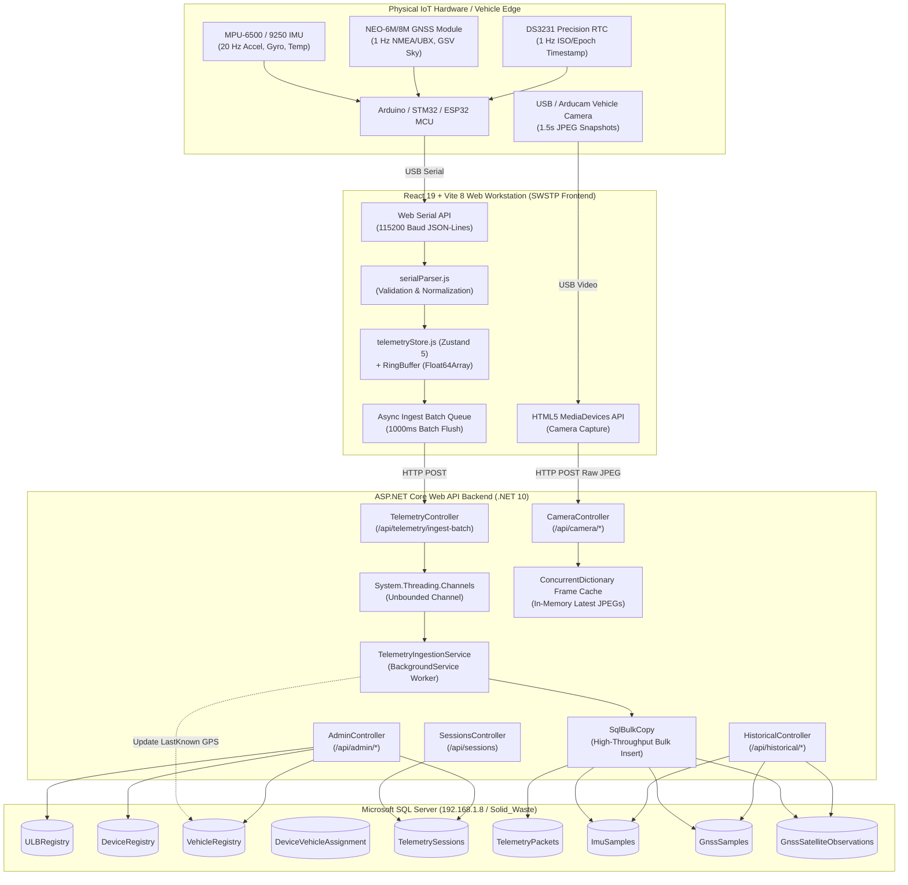

# Solid Waste Segregation & Telemetry Platform (SWSTP)
## Comprehensive Technical Architecture, Functioning, Database & Routing Specification

> **Document Version:** 2.0.0  
> **System Name:** Solid Waste Segregation & Telemetry Platform (SWSTP)  
> **Target Environment:** ASP.NET Core (.NET 10) · Entity Framework Core · Microsoft SQL Server · React 19 · Vite 8 · Web Serial API · IIS  
> **Repository Root:** `c:\Users\om.rathod\Desktop\Solid Waste`

---

## 1. System Overview & Purpose

The **Solid Waste Segregation & Telemetry Platform (SWSTP)** is an enterprise-grade IoT telemetry and fleet operations workstation designed for municipal solid waste management. It provides real-time tracking, sensor diagnostics, multi-tenant fleet monitoring, historical replay, and remote camera feeds for garbage collection vehicles (compactors, tippers, dumper placers) operating across multiple Urban Local Bodies (ULBs).

The platform bridges physical embedded hardware (microcontrollers, IMU inertial sensors, GNSS/GPS modules, RTC clocks, and vehicle cameras) with a high-density, real-time web monitoring and administration infrastructure.



---

## 2. Technology Stack & Key Libraries

### 2.1 Frontend Architecture (`/swstp`)
* **Core Framework:** React 19.x with Vite 8.x
* **State Management:** 
  * [Zustand 5](https://github.com/pmndrs/zustand) for reactive UI state, sensor health, and fault detection
  * Pre-allocated typed circular arrays (`Float64Array`) via custom `TelemetryBuffers` / `RingBuffer.js` for zero-allocation high-frequency (20–60 Hz) chart rendering
* **Routing:** `react-router-dom` v7 (Top-level URL routing) + Zustand state-machine view switcher (Inner `/debug` sub-screen switcher)
* **High-Performance Canvas Charts:** `uPlot` v1.6 (High-frequency synchronized multi-trace canvas charts)
* **3D Visualization:** `three` v0.170 + `@react-three/fiber` v9 + `@react-three/drei` v10 (Real-time 60 FPS IMU 3D model orientation & 3D GNSS Satellite Sky Dome)
* **Interactive Maps:** `leaflet` v1.9 + `react-leaflet` v5 (Speed-encoded trajectories, safe-zone geofence perimeters, heading vector markers)
* **Grid Layout:** `react-grid-layout` v2.2 (Customizable and persistent draggable/resizable engineering dashboard)
* **Design System & Styling:** Vanilla CSS with custom tokens in `index.css`, supporting Light & Dark themes with zero CSS framework bloat

### 2.2 Backend Architecture (`/backend/SWSTP.Telemetry.Backend`)
* **Framework:** ASP.NET Core (.NET 10 / C# 14)
* **ORM & Data Access:** Entity Framework Core (EF Core 10) + `Microsoft.Data.SqlClient`
* **High-Throughput Ingestion:** `System.Threading.Channels` producer-consumer pipeline with `SqlBulkCopy` transactional writing
* **In-Memory Cache:** `ConcurrentDictionary` for lock-free camera frame caching and GSV satellite sequence deduplication
* **API Documentation:** Swashbuckle Swagger / OpenAPI 3.0
* **Deployment Servers:** Windows Server IIS (Internet Information Services) with URL Rewrite module & ASP.NET Core Module V2

---

## 3. Frontend Navigation & Routing System

The application uses an **isolated two-layer navigation architecture**:
1. **Outer Layer (`router.jsx`):** Browser-history-aware URL routing powered by `react-router-dom`.
2. **Inner Layer (`DebugLayout.jsx` + `Navigation.jsx` + `telemetryStore.js`):** Reactive state-machine view switcher inside `/debug`.

```
======================================================================================
 OUTER LAYER (react-router-dom) — URL & Role-Based Entry Screens
======================================================================================
  │
  ├── / (HomeView) ─── Main Console Launcher (4 tiles: Debug, Commission, Admin, Officer)
  │
  ├── /debug (DebugLayout) ─── Full Engineering Telemetry Workstation
  │     │
  │     └── [ INNER LAYER: Zustand activeView State-Machine ]
  │           ├── overview      ─── 3-column dense overview & primary instruments
  │           ├── telemetry     ─── Stacked uPlot traces with synchronized cursor
  │           ├── workspace     ─── Custom draggable/resizable react-grid-layout
  │           ├── diagnostics   ─── Real-time packet quality & sensor self-tests
  │           ├── imu           ─── 3D MPU-6500/9250 interactive board orientation
  │           ├── map           ─── Live Leaflet GPS trajectory & heading vectors
  │           ├── gnss          ─── 3D Celestial Sky Dome & Satellite SNR bars
  │           ├── camera        ─── Live USB webcam stream + HUD overlay
  │           ├── sessions      ─── Hardware & simulation test runs
  │           ├── replay        ─── Timeline scrubbing historical replay engine
  │           └── system        ─── Hardware health, uptime, thermal & comms log
  │
  ├── /hardware-connect (HardwareConnectView) ─── Hardware Commissioning & Provisioning
  │     └── Connects Web Serial, queries DB DeviceRegistry ➔ Vehicle ➔ ULB mapping,
  │         displays live streaming bitrate/loss, and runs local camera frame capture.
  │
  ├── /admin (AdminView) ─── Multi-Tenant Cross-ULB Administrative Console
  │     ├── Fleet Live  ─── Cross-ULB vehicle map with active & offline last-known pins
  │     ├── Live Debug  ─── Cloud-streamed live telemetry traces without direct serial
  │     ├── Sessions    ─── Cross-ULB filterable historical sessions
  │     ├── Vehicles    ─── All vehicles, capacities, safe-zone radii, live camera popups
  │     └── Devices     ─── Hardware registry, 30s heartbeat check, vehicle assignments
  │
  └── /officer?ulb=<ULB_CODE> (OfficerView) ─── Scoped Municipal Field Officer Console
        ├── Fleet Map   ─── Operational live map strictly scoped to specified ULB
        ├── Vehicles    ─── Scoped vehicles & live camera inspection
        ├── Session Logs─── Historical sessions for this ULB only
        └── Devices     ─── Hardware devices assigned to this ULB
======================================================================================
```

---

## 4. Comprehensive View Breakdown & Features

### 4.1 Entry Console (`/` — `HomeView.jsx`)
* Central entry point displaying system connectivity status (`SYSTEM ONLINE · 192.168.1.8`).
* Four interactive launch tiles:
  1. **Engineering Debug (`/debug`):** Full telemetry workstation for hardware verification.
  2. **Hardware Connect (`/hardware-connect`):** Minimal commissioning interface for technicians.
  3. **Admin Console (`/admin`):** Cross-ULB aggregate view and remote live debugging.
  4. **ULB Officer View (`/officer?ulb=...`):** Field operations console scoped to an explicit municipality.

### 4.2 Hardware Commissioning Console (`/hardware-connect` — `HardwareConnectView.jsx`)
* **Auto-Detection:** Automatically invokes `navigator.serial.getPorts()` on mount to re-establish connection to authorized hardware without user prompting.
* **Identity Resolution:** Communicates with backend (`POST /api/sessions/start-hardware-session`) upon receiving the first serial packet to resolve `DeviceCode` ➔ `VehicleRegistrationNumber` ➔ `UlbName`.
* **Transport Quality Panel:** Live packets received, actual data frequency (Hz), and packet loss percentage.
* **Camera Capture Subsystem:** Integrates `useCameraCapture.js` to capture 1.5s interval JPEG frames via browser `getUserMedia` and stream them to `POST /api/camera/{deviceId}/frame`.

### 4.3 Multi-Tenant Admin Console (`/admin` — `AdminView.jsx` & `AdminPanels.jsx`)
* **ULB Summary Ribbon:** Aggregate cards for each municipality showing total vehicles, active devices, and live sessions today.
* **Tabs:**
  1. **Fleet Live:** Map visualizer plotting all active vehicles (colored by ULB) with heading arrows, plus offline depot vehicles with dashed gray markers and last known coordinates.
  2. **Live Debug:** Enables central administrators to remotely monitor live telemetry of any operating vehicle without a physical USB serial connection. Polls `GET /api/admin/sessions/{id}/live` every 1.5s to render real-time charts, 3D IMU board, and satellite tracking.
  3. **Sessions:** Filterable table of past and ongoing sessions across all ULBs with duration calculations.
  4. **Vehicles:** Master vehicle table showing registration numbers, vehicle types, tonnage capacities, safe-zone geofence radius, assigned device code, and an interactive **Live Camera Feed** modal.
  5. **Devices:** Complete hardware registry showing hardware revision (`REV_2.1_AVR`), firmware version (`v2.4.0`), active vehicle assignments, and real-time online status (green if `LastSeenAt` < 30 seconds ago).

### 4.4 Municipal Officer Console (`/officer?ulb=<ULB_CODE>` — `OfficerView.jsx`)
* **Strict Scoping:** Requires `?ulb=<ULB_CODE>` in URL. If omitted, renders an explicit warning screen.
* **Operational KPI Ribbon:** Scoped counters for *Total Fleet*, *Active in Field*, *Depot / Offline*, and *Safe Zone Perimeter*.
* **Restricted Access:** Excludes cross-ULB switchers and raw engineering debug tools; provides operational vehicle tracking, session logs, and vehicle camera inspection scoped 100% to that municipality.

### 4.5 Engineering Workstation (`/debug` — `DebugLayout.jsx`)
Features 11 specialized sub-screens:
1. **Overview (`Overview.jsx` / `OverviewPresentation.jsx`):** Non-scrolling 3-column control room view featuring primary digital gauges (Speed km/h, Altitude m, Heading °), 3-axis acceleration bars, live mini-traces, and satellite counts.
2. **Telemetry Analysis (`TelemetryAnalysis.jsx`):** Stacked canvas-rendered uPlot charts with synchronized crosshairs across 8 signal groups:
   - Speed ($km/h$) & Altitude ($m$)
   - Acceleration $X, Y, Z$ ($m/s^2$) & Magnitude ($m/s^2$)
   - Gyroscope $X, Y, Z$ ($^\circ/s$)
   - Roll, Pitch, Yaw ($^\circ$) & Heading ($^\circ$)
3. **Custom Workspace (`WorkspaceView.jsx`):** Draggable, resizable widget layout powered by `react-grid-layout` with presets (*Stacked*, *Quad Split*, *IMU 3D Layout*) saved to `localStorage`.
4. **Diagnostics Center (`DiagnosticsView.jsx`):**
   - Live hardware status indicators (GNSS, IMU, RTC, Camera, Comms).
   - Packet rate tracker (Expected 20 Hz vs Actual Hz, Jitter ms, Dropped packets).
   - Automated 4-sensor self-test suite (`[ TEST IMU ]`, `[ TEST GNSS ]`, `[ TEST RTC ]`, `[ TEST COMMS ]`).
   - Telemetry contract specification viewer.
5. **3D IMU View (`IMUView.jsx` / `IMUBoard3D.jsx`):** Real-time 3D rendering of the MPU breakout board using Three.js / React Three Fiber with 60 FPS quaternion rotations, coordinate axes ($+X$ Red, $+Y$ Green, $+Z$ Blue), and sign inversion toggles.
6. **Map Trajectory (`MapView.jsx` / `MapPresentation.jsx`):** Dark Leaflet map with speed-colorized historical breadcrumb path, live position puck, and course vector.
7. **GNSS Satellites (`GNSSView.jsx` / `GNSSPresentation.jsx` / `GNSSGlobe3D.jsx`):** 3D sky dome sphere and polar azimuth-elevation plot tracking PRNs across GPS, GLONASS, Galileo, and BeiDou, alongside live SNR (dB-Hz) bar charts.
8. **Live Camera Feed (`CameraView.jsx`):** HTML5 MediaDevices webcam feed with real-time HUD telemetry overlay (Speed, Course, GPS Coordinates, Timestamp).
9. **Sessions View (`SessionsView.jsx`):** Local and remote database session history.
10. **Replay View (`ReplayView.jsx`):** Full telemetry playback engine with timeline scrubbing, playback rate controls (1x, 2x, 5x, 10x), step-forward/backward, and synchronized map/chart rewinding.
11. **System View (`SystemView.jsx`):** Controller junction temperature, battery percentage, uptime counters, transport statistics, and real-time event log.

---

## 5. Telemetry Data Pipeline & Protocol Contract

### 5.1 Serial Data Ingestion Pipeline
1. **Hardware Emission:** Microcontroller outputs single-line JSON (`\n` terminated) over USB Serial at **115,200 Baud**.
2. **Web Serial Stream:** `RealSerialTelemetrySource.js` reads stream chunks via `ReadableStreamBYOBReader` and buffers complete lines.
3. **Parser & Normalizer:** `serialParser.js` parses the JSON line, converts raw IMU units (g to $m/s^2$), extracts orientation/quaternions, processes NMEA satellite details, and handles null GPS coordinates safely (never turning `null` into `0.0`).
4. **Ring Buffer Storage:** `telemetryStore.js` appends data into pre-allocated `Float64Array` circular buffers (1,200 sample capacity) with zero garbage collection overhead.
5. **Async Batch Flushing:** Packets are queued in `_pendingBatchQueue` and flushed every **1,000ms** via `POST /api/telemetry/ingest-batch` to the backend.

### 5.2 Canonical JSON Telemetry Packet Contract
```json
{
  "type": "telemetry",
  "seq": 1527,
  "device_id": "SWSTP-DEV-000001",
  "uptime_ms": 183420,
  "rtc": {
    "valid": true,
    "timestamp": "2026-08-17T11:12:14.000Z",
    "epoch": 1786628534000,
    "synced": true
  },
  "imu": {
    "valid": true,
    "accel_g": { "x": 0.001, "y": -0.002, "z": 0.998 },
    "accel_ms2": { "x": 0.0098, "y": -0.0196, "z": 9.7860 },
    "accel_magnitude_ms2": 9.8060,
    "gyro_dps": { "x": 0.03, "y": -0.01, "z": 0.02 },
    "temperature_c": 31.25,
    "orientation": { "roll": 0.8, "pitch": -1.2, "yaw": 14.3, "yaw_source": "GYRO_INTEGRATED" },
    "quaternion": { "w": 0.99, "x": 0.01, "y": -0.01, "z": 0.12 }
  },
  "gnss": {
    "data_received": true,
    "fix": true,
    "status": "FIX_3D",
    "latitude": 21.145800,
    "longitude": 79.088200,
    "altitude_m": 312.4,
    "speed_kmh": 24.5,
    "course_deg": 183.2,
    "satellites": 12,
    "satellites_in_view": 14,
    "satellites_used": 10,
    "hdop": 0.9,
    "gsv_seq": 452,
    "satellites_detail": [
      {
        "prn": 14,
        "constellation": "GPS",
        "elevation": 45.0,
        "azimuth": 120.0,
        "snr": 38.5,
        "used_in_fix": true,
        "status": "USED IN FIX"
      }
    ]
  },
  "system": {
    "uptime_ms": 183420,
    "battery": 100.0,
    "temperature": 31.25
  },
  "status": {
    "rtc": "ACTIVE",
    "imu": "ACTIVE",
    "gnss": "ACTIVE",
    "serial": "CONNECTED",
    "baud": 115200
  }
}
```

---

## 6. Database Architecture & Schema Details

* **Database Engine:** Microsoft SQL Server
* **Connection String Host:** `Server=192.168.1.8;Database=Solid_Waste;`
* **Context Class:** `SWSTP.Telemetry.Backend.Data.TelemetryDbContext`

```mermaid
erDiagram
    ULBRegistry ||--o{ VehicleRegistry : "contains"
    DeviceRegistry ||--o{ DeviceVehicleAssignment : "assigned to"
    VehicleRegistry ||--o{ DeviceVehicleAssignment : "receives"
    DeviceRegistry ||--o{ TelemetrySessions : "originates"
    DeviceVehicleAssignment ||--o{ TelemetrySessions : "binds"
    TelemetrySessions ||--o{ TelemetryPackets : "contains"
    TelemetrySessions ||--o{ GnssEvents : "logs"
    TelemetrySessions ||--o{ SystemEvents : "logs"
    TelemetryPackets ||--o{ ImuSamples : "contains"
    TelemetryPackets ||--o{ GnssSamples : "contains"
    TelemetryPackets ||--o{ GnssSatelliteObservations : "records"

    ULBRegistry {
        string UlbId PK
        string UlbName
        double SafeZoneLatitude
        double SafeZoneLongitude
        double SafeZoneRadiusMeters
        datetime CreatedAt
    }

    DeviceRegistry {
        bigint DeviceId PK
        string DeviceCode UK
        string HardwareVersion
        string FirmwareVersion
        datetime RegisteredAt
        datetime LastSeenAt
        bool IsActive
        string MetadataJson
    }

    VehicleRegistry {
        bigint VehicleId PK
        string VehicleRegistrationNumber UK
        string VehicleType
        double CapacityTons
        string UlbId FK
        string UlbName
        string Status
        double LastKnownLatitude
        double LastKnownLongitude
        datetime LastKnownTimestamp
        bool LastKnownRtcValid
        double LastKnownSpeedKmh
        double LastKnownHeadingDeg
    }

    DeviceVehicleAssignment {
        bigint AssignmentId PK
        bigint DeviceId FK
        bigint VehicleId FK
        datetime AssignedAt
        datetime UnassignedAt
        string AssignedBy
        bool IsActive
    }

    TelemetrySessions {
        bigint SessionId PK
        string SessionCode
        bigint DeviceId FK
        bigint AssignmentId FK
        string DeviceCode
        string VehicleRegistrationNumber
        string Mode
        datetime StartedAt
        datetime EndedAt
        string Status
    }

    TelemetryPackets {
        bigint TelemetryPacketId PK
        bigint SessionId FK
        bigint SequenceNumber UK
        datetime ReceivedAt
        bigint ArduinoUptimeMs
        datetime RtcTimestamp
        string RawJson
        string ParserStatus
    }

    ImuSamples {
        bigint ImuSampleId PK
        bigint SessionId FK
        bigint SequenceNumber FK
        datetime Timestamp
        double AccelX
        double AccelY
        double AccelZ
        double AccelMagnitude
        double GyroX
        double GyroY
        double GyroZ
        double Roll
        double Pitch
        double Yaw
        double QuaternionW
        double QuaternionX
        double QuaternionY
        double QuaternionZ
        double TemperatureC
        bool IsValid
    }

    GnssSamples {
        bigint GnssSampleId PK
        bigint SessionId FK
        bigint SequenceNumber FK
        datetime Timestamp
        string FixStatus
        bool FixValid
        double Latitude
        double Longitude
        double AltitudeM
        double SpeedKmh
        double CourseDeg
        int SatellitesCount
        int SatellitesInView
        int SatellitesUsed
        double Hdop
        int GsvSeq
    }

    GnssSatelliteObservations {
        bigint ObservationId PK
        bigint SessionId FK
        bigint SequenceNumber FK
        datetime ObservedAt
        int Prn
        string Constellation
        double ElevationDeg
        double AzimuthDeg
        double SnrDbHz
        bool UsedInFix
        string Status
    }
```



### 6.1 Database Tables & Key Columns

| Table Name | Primary Key | Key Constraints / Indexes | Purpose |
| :--- | :--- | :--- | :--- |
| **`ULBRegistry`** | `UlbId` (`nvarchar(50)`) | Primary key | Master catalog of Urban Local Bodies (e.g. `ULB_MH_NAGPUR`, `ULB_MH_AMRAVATI`) and their geofencing safe-zone coordinates and radius. |
| **`DeviceRegistry`** | `DeviceId` (`bigint identity`) | `UQ_DeviceRegistry_DeviceCode` (Unique), FK `StatusStateDefinitionId` | Physical telemetry hardware devices, hardware/firmware revisions, and 30-second heartbeat check (`LastSeenAt`). |
| **`VehicleRegistry`** | `VehicleId` (`bigint identity`) | `UQ_VehicleRegistry_RegNumber` (Unique), Index on `UlbId`, FK `StatusStateDefinitionId` | Fleet vehicle profiles (compactors, tippers), capacity, and cached latest GPS location (`LastKnownLatitude`, `LastKnownLongitude`, `LastKnownTimestamp`). |
| **`DeviceVehicleAssignment`** | `AssignmentId` (`bigint identity`) | Filtered Unique on `(DeviceId)` and `(VehicleId)` where `IsActive = 1` | Provisioning history linking physical IoT units to specific municipal garbage collection trucks. |
| **`StateDefinitions`** | `StateDefinitionId` (`int identity`) | `UQ_StateDefinitions_EntityType_StateCode` (Unique) | Database-backed reference catalog for business states (`DEVICE`, `VEHICLE`, `OPERATIONAL_SESSION`, `COLLECTION_EVENT`). |
| **`EntityStateTransitions`** | `StateTransitionId` (`bigint identity`) | Index on `(EntityType, EntityId, ChangedAt DESC)` | Append-only auditable ledger recording state transitions for state-bearing domain entities. |
| **`AuditLogs`** | `AuditLogId` (`bigint identity`) | Index on `(UlbId, PerformedAt DESC)`, `(EntityType, EntityId, PerformedAt DESC)` | Municipal operational audit trail for session creation, road updates, vehicle reassignments, and evidence purging. |
| **`Roads`** | `RoadId` (`bigint identity`) | `UQ_Roads_UlbId_RoadCode` (Unique), FK `UlbId` | Master GIS road catalog scoped to ULB. |
| **`RoadGeometryVersions`** | `RoadGeometryVersionId` (`bigint identity`) | `UQ_RoadGeometryVersions_Road_Version` (Unique), `geography` column | Immutable versioned road centerlines (LineString, SRID 4326) ensuring reproducible historical coverage. |
| **`RoadSegments`** | `RoadSegmentId` (`bigint identity`) | Indexes on `(RoadId, Sequence)` and `(RoadGeometryVersionId)` | Natural operational sections between junctions/turns bound strictly to an immutable `RoadGeometryVersion`. |
| **`Houses`** | `HouseId` (`nvarchar(50)`) | Index on `(UlbId, IsActive)`, `geography` column | Master municipal property points for 10m collection impact calculations. |
| **`OperationalSessions`** | `OperationalSessionId` (`bigint identity`) | `UQ_OperationalSessions_SessionCode` (Unique), Filtered Unique on `(VehicleId)` where `IsActiveReservation = 1` | Municipal coverage missions with assigned roads. One vehicle can have at most one active/paused mission reservation. |
| **`SessionRoadAssignments`** | `SessionRoadAssignmentId` (`bigint identity`) | Index on `(OperationalSessionId, AssignedOrder)`, `geography` column | Target operational coverage geometry (full segment or trimmed subsegment) and spatial buffer (default 100m). |
| **`CollectionEvents`** | `CollectionEventId` (`bigint identity`) | Indexes on `(OperationalSessionId, CapturedAt)`, `(VehicleId, CapturedAt)`, `(SessionRoadAssignmentId)` | Motion-triggered collection evidence event with dual timestamping (`CapturedAt` RTC vs `ReceivedAt` server). |
| **`EvidenceImages`** | `EvidenceImageId` (`bigint identity`) | Index on `(CollectionEventId)` and `(ExpiresAt, DeletedAt)` | 21-day expiring JPEG image file references under `sessionimages/` with temporal lifecycle. |
| **`CollectionEventHouses`** | `CollectionEventHouseId` (`bigint identity`) | Indexes on `(CollectionEventId)` and `(HouseId)` | Temporal association mapping houses within 10m evidence radius without mutating master House entities. |
| **`TelemetrySessions`** | `SessionId` (`bigint identity`) | Index on `(Mode, StartedAt)` | Logged operational and test runs (`REAL_HARDWARE` vs `SIMULATION`), start/end times, and active status. |
| **`TelemetryPackets`** | `TelemetryPacketId` (`bigint identity`) | Alternate Unique Key `(SessionId, SequenceNumber)` | Raw JSON telemetry payloads, sequence numbers, and microcontroller millisecond uptimes. |
| **`ImuSamples`** | `ImuSampleId` (`bigint identity`) | Index on `(SessionId, Timestamp)` including Accel, Gyro, Orientation | High-frequency 20 Hz inertial telemetry: 3-axis acceleration, angular velocity, quaternions, and junction temperature. |
| **`GnssSamples`** | `GnssSampleId` (`bigint identity`) | Index on `(SessionId, FixValid, Timestamp)` including Lat, Lon, Speed, Course | 1 Hz GPS position records. Latitude, Longitude, and Altitude are strictly nullable (never stored as 0.0 on fix loss). |
| **`GnssSatelliteObservations`** | `ObservationId` (`bigint identity`) | Index on `(SessionId, Constellation, Prn, ObservedAt)` and `(SessionId, GsvSeq)` | Detailed satellite tracking records: PRN ID, Constellation (GPS, GLONASS, Galileo, BeiDou), elevation, azimuth, and SNR (dB-Hz). |
| **`GnssEvents`** | `GnssEventId` (`bigint identity`) | FK to `SessionId` | Discontinuous satellite events (fix acquired, fix lost, constellation transitions). |
| **`SystemEvents`** | `SystemEventId` (`bigint identity`) | FK to `SessionId` | System-level diagnostic logs, packet loss warnings, and sensor error alerts. |

---

## 7. Backend REST API Routing & Specifications

* **Development Base URL:** `http://localhost:5000/api`
* **Production Base URL:** `https://solidwasteapi.scipl.info.in/api`

### 7.1 Telemetry Ingestion Endpoints
* **`POST /api/telemetry/ingest-batch`**
  * **Description:** Queues a batch of normalized telemetry packets from client into `System.Threading.Channels` for asynchronous bulk insertion via `SqlBulkCopy`.
  * **Payload:** `IngestBatchDto` containing `sessionId`, `mode`, and an array of `packets`.
  * **Response:** `{ "status": "QUEUED", "count": 15 }`

### 7.2 Session Management Endpoints
* **`GET /api/sessions?mode={REAL_HARDWARE|SIMULATION}&limit=50`**
  * **Description:** Retrieves recent telemetry sessions with device and vehicle assignment details.
* **`POST /api/sessions/start-hardware-session`**
  * **Description:** Checks `DeviceRegistry` for active registration, updates `LastSeenAt`, resolves active `DeviceVehicleAssignment`, and returns or creates an active `TelemetrySession`.
  * **Body:** `{ "deviceCode": "SWSTP-DEV-000001", "mode": "REAL_HARDWARE" }`
  * **Error Response:** 400 Bad Request if device is unregistered (`"UNREGISTERED_DEVICE"`).
* **`POST /api/sessions/{sessionId}/end?status=COMPLETED`**
  * **Description:** Sets `EndedAt = DateTime.UtcNow` and marks session status as `COMPLETED` or `ABORTED`.
* **`GET /api/sessions/devices`**
  * **Description:** Returns all registered devices and their currently active vehicle registration numbers.

### 7.3 Historical Analytics Endpoints
* **`GET /api/historical/sessions/{sessionId}/gnss-trajectory?limit=2000`**
  * **Description:** Returns ordered GPS coordinates (`lat`, `lon`, `alt`, `speed`, `heading`, `timestamp`) for map rendering and replay.
* **`GET /api/historical/sessions/{sessionId}/imu-history?limit=2000`**
  * **Description:** Returns ordered IMU samples (`accelX/Y/Z`, `gyroX/Y/Z`, `roll`, `pitch`, `yaw`).
* **`GET /api/historical/sessions/{sessionId}/satellites`**
  * **Description:** Returns aggregated satellite tracking statistics per PRN (peak SNR, tracked duration, elevation, azimuth, used in fix).

### 7.4 Multi-Tenant Admin & Officer Endpoints
* **`GET /api/admin/ulbs`**
  * **Description:** Returns all Urban Local Bodies with geofencing coordinates, total registered vehicles, and active sessions today.
* **`GET /api/admin/vehicles?ulbId={optional}`**
  * **Description:** Returns fleet vehicles across all ULBs or scoped to a specific ULB. Includes assigned device details and last known GPS location.
* **`GET /api/admin/devices`**
  * **Description:** Returns hardware registry with calculated `isOnline` boolean (true if `LastSeenAt` < 30 seconds).
* **`GET /api/admin/fleet/live?ulbId={optional}`**
  * **Description:** Real-time fleet tracking endpoint returning active vehicles from current sessions and offline vehicles with last known locations.
* **`GET /api/admin/sessions?ulbId={optional}&limit=100`**
  * **Description:** Filterable session history scoped optionally by municipality.
* **`GET /api/admin/sessions/{sessionId}/live`**
  * **Description:** Cloud telemetry streaming endpoint for the **Live Debug** panel. Returns latest GNSS fix, latest IMU sample, RTC sync status, and the last 40 trajectory/trace points.

### 7.5 Camera Subsystem Endpoints
* **`POST /api/camera/{deviceId}/frame`**
  * **Description:** Accepts raw JPEG binary payloads (`image/jpeg` or `application/octet-stream`) up to 2MB. Validates JPEG magic bytes (`FF D8 FF`) and caches in memory atomically.
* **`GET /api/camera/{deviceId}/latest?ulbId={optional}`**
  * **Description:** Streams the latest JPEG frame (`image/jpeg`). If `ulbId` is provided (Officer path), server enforces that the requested device is actively assigned to a vehicle belonging to that ULB (returning 403 if mismatched).
* **`GET /api/camera/{deviceId}/meta`**
  * **Description:** Lightweight endpoint returning capture timestamp and frame byte size for staleness polling.

### 7.6 System Health Endpoint
* **`GET /api/health`**
  * **Description:** Evaluates database connectivity (`_db.Database.CanConnectAsync()`) and returns `200 OK (HEALTHY)` or `503 Service Unavailable (DEGRADED/UNHEALTHY)`.

---

## 8. Multi-Tenancy, Scoping & Security

1. **Role-Based Tenant Scoping:**
   - **Admin View:** Full visibility across all ULBs. Can view global fleet maps, aggregate statistics, and remote live debugging.
   - **Officer View:** Strictly constrained to a single municipality via `?ulb=<ULB_CODE>`. All queries (`/api/admin/fleet/live?ulb=...`, `/api/admin/vehicles?ulb=...`) are scoped on the server.
2. **Server-Side Camera Access Enforcement:**
   - Camera frame access at `GET /api/camera/{deviceId}/latest?ulbId=...` traverses the database relationship chain:
     $$\text{DeviceRegistry} \longrightarrow \text{DeviceVehicleAssignment} \longrightarrow \text{VehicleRegistry.UlbId}$$
   - If the assigned vehicle does not belong to the requested `ulbId`, the backend returns `403 Forbidden` (`ULB_SCOPE_VIOLATION`), ensuring officers cannot view video feeds from other municipalities.
3. **CORS Configuration:**
   - Explicitly configured in `Program.cs` and `appsettings.json` to allow requests from authorized origins:
     - `https://solidwaste.scipl.info.in`
     - `https://solidwasteapi.scipl.info.in`
     - `http://localhost:5173`
     - `http://127.0.0.1:5173`

---

## 9. Production Deployment & IIS Configuration

### 9.1 Frontend SPA Deployment (`/deploy/frontend`)
* Compiled using `npm run build` into static assets (`index.html`, JavaScript, CSS, SVGs).
* Deployed under Windows IIS with URL Rewrite rules defined in `web.config` to support client-side HTML5 history routing without 404 errors:
```xml
<?xml version="1.0" encoding="utf-8"?>
<configuration>
  <system.webServer>
    <rewrite>
      <rules>
        <rule name="React SPA Fallback" stopProcessing="true">
          <match url=".*" />
          <conditions logicalGrouping="MatchAll">
            <add input="{REQUEST_FILENAME}" matchType="IsFile" negate="true" />
            <add input="{REQUEST_FILENAME}" matchType="IsDirectory" negate="true" />
            <add input="{REQUEST_URI}" pattern="^/api" negate="true" />
          </conditions>
          <action type="Rewrite" url="/index.html" />
        </rule>
      </rules>
    </rewrite>
  </system.webServer>
</configuration>
```

### 9.2 Backend API Deployment (`/deploy/backend`)
* Published using `dotnet publish -c Release` into `/deploy/backend`.
* Configured under IIS with `AspNetCoreModuleV2` running in in-process hosting mode:
```xml
<?xml version="1.0" encoding="utf-8"?>
<configuration>
  <system.webServer>
    <handlers>
      <add name="aspNetCore" path="*" verb="*" modules="AspNetCoreModuleV2" resourceType="Unspecified" />
    </handlers>
    <aspNetCore processPath="dotnet" arguments=".\SWSTP.Telemetry.Backend.dll" stdoutLogEnabled="false" stdoutLogFile=".\logs\stdout" hostingModel="inprocess" />
  </system.webServer>
</configuration>
```

---

## 10. Summary of Key Files in the Repository

```
Solid Waste/
├── SITE_ARCHITECTURE_AND_FUNCTIONING.md   # This master technical specification
├── backend/
│   └── SWSTP.Telemetry.Backend/
│       ├── Controllers/
│       │   ├── AdminController.cs         # Cross-ULB & scoped fleet, vehicle, device & live session endpoints
│       │   ├── CameraController.cs        # In-memory JPEG frame cache & ULB-scoped camera endpoints
│       │   ├── HealthController.cs        # Database connection health check
│       │   ├── HistoricalController.cs    # Historical GNSS trajectories, IMU series & satellite statistics
│       │   ├── SessionsController.cs      # Session initialization, device registration & listing
│       │   └── TelemetryController.cs     # Ingestion batch receiver
│       ├── Data/
│       │   └── TelemetryDbContext.cs      # EF Core DbContext, entity mapping, foreign keys & indexes
│       ├── Migrations/                    # EF Core schema migration history
│       ├── Models/                        # C# database entities and DTO contracts
│       ├── Services/
│       │   ├── ITelemetryIngestionService.cs
│       │   └── TelemetryIngestionService.cs # BackgroundService with Channels and SqlBulkCopy
│       ├── Program.cs                     # DI configuration, DbContext setup, CORS & middleware
│       └── appsettings.json               # MSSQL connection string and CORS origins
├── deploy/
│   ├── backend/                           # Compiled production binaries for IIS ASP.NET Core
│   └── frontend/                          # Compiled Vite production build for IIS SPA hosting
└── swstp/
    ├── public/web.config                  # IIS URL rewrite rules for SPA client routing
    └── src/
        ├── App.jsx                        # Root React component
        ├── ThemeContext.jsx               # Dark/Light theme provider and Carto map tile switcher
        ├── index.css                      # Master CSS design system and theme variables
        ├── router.jsx                     # Top-level React Router (/, /debug, /hardware-connect, /admin, /officer)
        ├── layouts/
        │   └── DebugLayout.jsx            # Engineering workstation layout with inner Zustand view switcher
        ├── components/
        │   ├── AdminPanels.jsx            # Shared panels: Fleet Live, Live Debug, Sessions, Vehicles, Devices
        │   ├── CameraViewer.jsx           # Reusable camera viewer with staleness polling
        │   ├── GNSSGlobe3D.jsx            # 3D Celestial Sky Dome for satellite visualization
        │   ├── IMUBoard3D.jsx             # 3D MPU breakout board with Three.js / React Three Fiber
        │   ├── Navigation.jsx             # Left sidebar navigation with hardware connection status
        │   └── TelemetryChart.jsx         # Canvas-based uPlot chart wrappers
        ├── telemetry/
        │   ├── RealSerialTelemetrySource.js # Web Serial API transport implementation
        │   ├── backendApiClient.js        # REST API client for backend communication
        │   ├── gnssHistoryStore.js        # GSV satellite snapshot accumulator and history
        │   ├── serialParser.js            # Serial JSON-lines parser and validator
        │   ├── telemetryStore.js          # Master Zustand telemetry store and RingBuffer manager
        │   ├── useCameraCapture.js        # getUserMedia webcam frame capture hook
        │   └── useHardwareConnection.js   # Shared serial connection and auto-reconnect hook
        └── views/
            ├── AdminView.jsx              # /admin Multi-tenant console
            ├── CameraView.jsx             # Live webcam streaming view with telemetry HUD overlay
            ├── DiagnosticsView.jsx        # Hardware health, transport quality & self-tests
            ├── GNSSView.jsx               # GNSS satellite tracking and sky view
            ├── HardwareConnectView.jsx    # /hardware-connect commissioning screen
            ├── HomeView.jsx               # / Root launcher screen
            ├── IMUView.jsx                # 3D IMU orientation visualizer
            ├── MapView.jsx                # GPS breadcrumb trajectory map
            ├── OfficerView.jsx            # /officer Single-ULB operational console
            ├── Overview.jsx               # Multi-metric control workstation
            ├── ReplayView.jsx             # Historical telemetry playback and scrubber
            ├── SessionsView.jsx           # Session logs and records
            ├── SystemView.jsx             # Thermal, uptime and comms diagnostics
            └── WorkspaceView.jsx          # Custom react-grid-layout workspace
```
